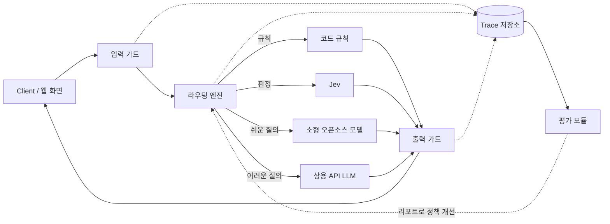

# LLMOps

LLM gateway with guardrails, cost-aware routing (rules · Jev · open-source SLMs · frontier APIs), and automated evaluation. Built with FastAPI and React.

OpenAI SDK의 `base_url`만 바꾸면 쉬운 요청은 값싼 소형 모델로, 어려운 요청은 상용 모델로 보내고, 위험한 입력은 모델에 닿기 전에 막고, **얼마를 아꼈는지** 보여 주는 게이트웨이이다. 라우팅 설정을 바꿀 때마다 비용·지연·정확도가 어떻게 달라지는지 직접 측정하는 평가 도구가 함께 들어 있다.

> 이 서비스가 **무엇을 제공하는지**(기능 요구사항, 현재 상태, 범위 밖)는 [docs/product.md](docs/product.md)에 정리했다.

## 특징

- **OpenAI 호환 API**: `POST /v1/chat/completions`. 기존 코드에서 주소와 키만 바꾸면 된다(스트리밍은 아직 없다).
- **비용 인식 라우팅**: 코드 규칙, 판정 모델(Jev)의 `p(easy)`, 신뢰도 임계값으로 소형/상용 모델을 고른다. 판정기가 실패하면 규칙 결과로 대체한다.
- **장애 대체**: 고른 모델이 실패하면 다른 경로의 실제 모델이 대신 답한다(가짜 응답으로 대신하지 않는다). 모두 실패하면 502이다.
- **입력 가드**: 빈 입력, 길이 초과, 영어·한국어 프롬프트 인젝션 규칙을 모델 호출 전에 검사한다.
- **투명성**: 모든 단계(판정 확률, 모델, 토큰, 비용, 지연)를 요청 ID와 함께 기록하고, 결정을 응답 헤더로 돌려준다.
- **웹 화면**: 요청이 지나간 단계, 경로, 비용, 아낀 금액을 보여 주는 React 화면(라이트/다크 모드).
- **측정 우선**: 평가 도구가 캐시를 재생해 임계값별 정확도·비용을 비교하고, 동결한 보류 데이터로 일반화를 확인한다.

## 빠른 시작

모든 provider의 기본값은 오프라인 mock이라 API 키 없이 바로 실행해 볼 수 있다.

### Docker로 실행

```bash
cp code/backend/.env.example code/backend/.env   # GATEWAY_API_KEY 에 임의의 긴 문자열을 채운다 (.env 는 커밋하지 않는다)
docker compose up --build
```

`http://localhost:8000/`에서 웹 화면이, 같은 주소의 `/v1/chat/completions`에서 API가 열린다.

> `Dockerfile`과 `compose.yaml`은 작성 환경에 Docker가 없어 `docker build`와 `docker compose up`을 직접 실행해 보지 못했다. 같은 단계(런타임 의존성만 설치, 앱 시작, 웹 화면과 API 응답, 새 데이터 폴더에 trace DB 생성)는 Docker 없이 확인했다. 실행해 보고 문제가 있으면 이슈로 알려 주기 바란다.

### 직접 실행 (uv + npm)

필요한 것: [uv](https://docs.astral.sh/uv/)(Python 3.12는 uv가 자동으로 받는다)와 Node.js(웹 화면을 빌드할 때만).

```bash
cd code/frontend && npm ci && npm run build      # 웹 화면 빌드 (건너뛰면 API만 동작하고 / 는 안내를 돌려준다)
cd ../backend
uv sync                                          # 의존성 설치 (.venv 생성)
cp .env.example .env                             # PowerShell: Copy-Item .env.example .env
                                                 # GATEWAY_API_KEY 에 임의의 긴 문자열을 채운다. .env 는 절대 커밋하지 않는다.
uv run uvicorn gateway.app:create_app --factory --port 8000
```

## OpenAI SDK로 연결하기

`base_url`과 `api_key`(= `GATEWAY_API_KEY`)만 바꾼다. `model` 값은 받아 주지만 라우터가 모델을 고른다.

```python
from openai import OpenAI

client = OpenAI(base_url="http://localhost:8000/v1", api_key="<GATEWAY_API_KEY>")
reply = client.chat.completions.create(model="auto", messages=[{"role": "user", "content": "안녕하세요"}])
print(reply.choices[0].message.content)
```

라우팅 결정은 응답 헤더로 읽는다.

```python
raw = client.chat.completions.with_raw_response.create(
    model="auto", messages=[{"role": "user", "content": "What is 2+2?"}]
)
print(raw.headers["X-LLMOps-Route"], raw.headers["X-LLMOps-Cost-USD"])
reply = raw.parse()
```

```bash
curl http://localhost:8000/v1/chat/completions \
  -H "Authorization: Bearer $GATEWAY_API_KEY" -H "Content-Type: application/json" \
  -d '{"messages":[{"role":"user","content":"안녕하세요"}]}'
```

오류는 OpenAI와 같은 모양(`{"error": {"message", "type", "param", "code"}}`)이라 SDK의 예외 타입으로 그대로 올라온다(openai 파이썬 SDK 3.42.1로 확인: 401은 `AuthenticationError`, 입력 가드 차단은 `BadRequestError`, 검증 오류 422는 `UnprocessableEntityError`).

### 응답 헤더

| 헤더 | 의미 |
|---|---|
| `X-Request-ID` | 이 요청의 trace 키 |
| `X-LLMOps-Route` | 라우터가 고른 경로(`small` / `frontier`) |
| `X-LLMOps-Fallback` | 다른 모델이 대신 답했는지(`true` / `false`). 답한 모델은 본문의 `model` |
| `X-LLMOps-Route-Reason` | 사유 범주(`judge_easy`, `promoted_low_confidence`, `keyword` 등) |
| `X-LLMOps-P-Easy` | 판정기가 낸 `p(easy)`(판정기를 거친 요청만) |
| `X-LLMOps-Cost-USD` | 이 요청의 비용(판정 호출 포함) |
| `X-LLMOps-Baseline-Cost-USD` | 같은 답을 상용 모델 단가로만 계산한 값. 상용 단가가 설정되지 않으면 생략. 둘의 차이가 아낀 금액(추정치) |

## 개요

LLM 요청이 지나가는 하나의 경로(**입력 가드 → 라우팅 → 모델 호출 → 출력 가드**)를 FastAPI 게이트웨이로 만들고, 모든 단계를 기록해 **설정을 바꿀 때마다 비용·지연·정확도·방어율을 자동으로 측정**하는 것이 목표이다.

핵심 원칙은 **역할 분리**이다. 하나의 모델에 모든 것을 맡기지 않고, 일의 성격에 맞는 도구를 배치한다.

| 구성요소 | 맡는 역할 |
|---|---|
| 코드·규칙 | 정확한 계산, 정규식, 임계값 비교, 1차 필터 |
| Jev | 선택지가 정해진 판정(분류, yes/no + 확률, 점수) |
| 소형 오픈소스 모델 (Transformers / vLLM) | 쉬운 질의 응답, 직접 파인튜닝한 분류기·judge |
| 상용 API LLM | 어려운 추론, 긴 답변, 평가 기준(reference) 생성 |

Jev를 포함한 어떤 provider도 같은 인터페이스로 교체할 수 있게 설계하며, 같은 판정을 여러 방식으로 돌려 비교하는 것 자체가 평가 항목이다.

## 아키텍처



## 디렉터리 구조

Python 백엔드는 모두 `code/backend/` 아래에, 웹 화면(React)은 `code/frontend/`에 있다. 문서(설계, 결정 기록, 평가 결과)는 루트의 `docs/`이다. 자세한 개발 안내는 [code/backend/README.md](code/backend/README.md)와 [code/frontend/README.md](code/frontend/README.md)에 있다.

| 경로 (`code/backend/` 기준) | 설명 |
|---|---|
| `gateway/` | FastAPI 게이트웨이 (OpenAI 호환 API, 인증, trace 기록, 웹 화면 서빙) |
| `guards/` | 입력·출력 가드레일 (프롬프트 인젝션, PII, 정책 위반) |
| `router/` | 라우팅 엔진 (규칙 · Jev · 모델 선택, 신뢰도 임계값, 판정 정책) |
| `providers/` | 모델 provider 추상화 (Jev, 상용 API, HF/vLLM) |
| `evals/` | 평가 데이터셋, judge, 벤치마크, 리포트 |

## 로드맵

- [x] **0. 기반**: 레포 구조, 환경 변수, 게이트웨이 골격
- [x] **1. 한 줄 관통**: 입력 가드 → 라우터 → LLM 호출 → trace 저장 (mock provider 기준으로 관통, 실제 모델 호출은 스모크 스크립트로 별도 확인)
- [x] **2. 라우팅 엔진 v1**: 규칙 + Jev + 모델 2종, 신뢰도 기반 승격 (Jev 어댑터를 실제 API로 확인함. 정책 v1은 80문항 전부 easy로 판정해 v2a로 개선하고 기본으로 채택함)
- [x] **3. 평가 v1**: 데이터셋, judge, 비용·지연·정확도 리포트 (Qwen + Jev로 80문항 첫 실측 완료: [결과](docs/evals/2026-10-13_qwen-first-run.md). n=80, 난이도 라벨은 검토 전이라 관찰로 읽을 것)
- [ ] **4. 가드 고도화**: 인젝션·PII 탐지, 공격 프롬프트 자동 생성, 방어율 측정
- [ ] **5. 파인튜닝**: 라우팅/가드 분류기, 소형 judge (1B 이하 모델 위주)
- [ ] **6. 벤치마크**: LLM 단독 vs 하이브리드, Jev vs 파인튜닝 분류기 vs LLM judge
- [ ] **7. 마무리**: 대시보드 정리, 회고 (최소 웹 화면은 먼저 구현함: [웹 화면](#웹-화면))

그 밖에 필요한 것은 스트리밍, 출력 가드, 키별 trace 조회, 사용자별 키·요청 한도, PostgreSQL이다. 상태는 [docs/product.md](docs/product.md)의 요구사항 표에 있다.

## 개발 환경 상세

```bash
cd code/backend        # 이하 Python 명령은 모두 여기서 실행한다 (.env도 이 폴더에 둔다)
uv run pytest                                        # 테스트 (네트워크 없음)
uv run ruff check . && uv run ruff format --check .  # 린트
```

- 응답 헤더의 `X-Request-ID`가 trace의 키이다. 기본 저장소는 `code/backend/data/traces.sqlite3`(SQLite, 커밋되지 않음)이며 단계별(`guard` → `router` → `provider`) 판정·토큰·비용·지연이 기록된다.
- 입력 가드가 막으면 400이다. 라우팅된 모델이 실패하면 다른 경로의 실제 모델이 대신 답하고(응답 헤더 `X-LLMOps-Fallback: true`, trace에 기록), 모두 실패하면 502이다.
- 실제 모델 연결은 `.env`의 `SMALL_PROVIDER` / `FRONTIER_PROVIDER`로 켠다. 한 번만 실제 호출을 확인하는 스모크 스크립트는 `scripts/smoke_live.py`(기본 비활성)이다.

### 웹 화면

질문을 보내면 경로·사유·`p(easy)`·모델·토큰·비용·아낀 금액·지연이 한 화면에 보이는 React 앱이다. 게이트웨이가 빌드 결과를 `/`로 서빙한다.

```bash
cd code/frontend
npm ci            # 의존성 설치
npm run build     # code/frontend/dist 생성 (게이트웨이가 / 로 제공)
# 게이트웨이를 켜고 http://localhost:8000/ 를 연다. 키는 화면의 입력칸에 넣는다(저장되지 않음).
npm run dev       # 개발 서버 http://localhost:5173/ (API는 8000 포트의 게이트웨이로 프록시)
npm test          # 단위 테스트
```

- `p(easy)`는 `ROUTER_MODE=hybrid`(또는 `judge_only`)에서 판정기를 거친 요청에만 표시된다. 실제 Jev로 보려면 `JUDGE_PROVIDER=jev`와 `ROUTER_PROMOTE_THRESHOLD=0.995` 같은 값이 필요하다.
- 화면을 끄려면 `WEB_UI_ENABLED=false`(API만 동작). 빌드하지 않으면 `/`는 빌드 안내와 함께 503을 돌려준다.
- 이력 표는 이번 접속에서 보낸 요청만 보여 주며 서버에 저장하지 않는다.
- **아낀 금액**: 모든 요청을 상용 모델로만 보냈다면 들었을 비용에서 실제 비용(판정 비용 포함)을 뺀 값이다. 같은 토큰 수로 계산한 추정치이고, 판정 비용이 큰 짧은 요청에서는 음수가 될 수 있다.
- **라이트/다크 모드**: 처음에는 OS 설정을 따르고, 오른쪽 위 토글로 바꾼다(선택은 이 브라우저에만 기억).
- **애니메이션**: 요청이 `입력 가드 → 라우터 → 모델 → 응답`을 지나는 과정, 답변 타이핑, `p(easy)` 게이지, 숫자 카운트업 등. OS에서 "동작 줄이기"를 켜 두면 모두 꺼진다.

### 라우팅 모드 (2단계)

`.env`의 `ROUTER_MODE`로 고른다. 기본값 `rules`는 규칙만 쓰고 판정기를 호출하지 않는다.

| 모드 | 동작 |
|---|---|
| `rules` | 길이·키워드 규칙만 (기본) |
| `hybrid` | 규칙에 걸리면 확정, 아니면 판정기(Jev)가 easy/hard와 확률을 판정. `p(easy) ≥ ROUTER_PROMOTE_THRESHOLD`(0.7)일 때만 소형 모델, 아니면 상용 모델로 승격 |
| `judge_only` | 항상 판정기에 질의 (규칙과 비교 실험용) |

판정기에 보내는 정책 문구는 `ROUTER_POLICY`로 고르며 기본은 `v2a`이다. v1은 Jev가 거의 모든 요청에 `easy`를 높은 확률로 답해 기본 임계값 0.7이 구분력을 잃었고, v2a는 "정답에 필요한 의존 단계 수"를 묻는다. 비교와 한계는 [정책 v2 검증](docs/evals/2026-10-19_policy-v2.md)에 있다. 2026-10-13 측정을 재현하려면 `ROUTER_POLICY=v1`(평가 도구는 `--policy v1`)을 쓴다.

`JUDGE_PROVIDER`의 기본값은 오프라인 mock(요청 길이만 보는 가짜)이라 키 없이 동작을 볼 수 있지만, 라우팅 품질의 근거는 아니다. 실제 Jev는 `JUDGE_PROVIDER=jev`와 `JEV_API_KEY`가 필요하며, 어댑터는 서드파티 문서를 기준으로 작성했고 2026-10-13에 실제 호출로 확인했다. 판정 호출은 trace에 `judge` 이벤트(확률, 토큰, 비용, 지연, 정책 버전)로 남는다. 정책 문구는 [docs/prompts/router-policy.md](docs/prompts/router-policy.md)에 있다.

### 평가 (3단계)

라우팅 설정을 바꿨을 때 비용·지연·정확도가 어떻게 달라지는지 측정한다. 판정기·소형 모델·상용 모델을 항목당 한 번씩만 호출해 캐시하고, 모드와 임계값(τ)을 바꾼 비교는 캐시를 재생해서 계산하므로 τ를 훑어도 추가 비용이 없다.

```bash
uv run python -m evals.run collect --name sample --limit 20   # 기본 mock, 키 없이 실행
uv run python -m evals.run report  --name sample            # code/backend/evals/reports/sample/report.md
```

데이터셋(영어·한국어 80개)은 AI가 작성했고 난이도 라벨은 검토 전이다. mock으로 만든 리포트는 파이프라인이 동작한다는 것만 보여 주며 정확도·비용 수치에는 의미가 없다 (리포트 상단에 경고가 표시된다). 자세한 내용은 [code/backend/evals/README.md](code/backend/evals/README.md).

현재 구현 범위(로드맵 0~3단계): 규칙 기반 입력 가드 · 규칙/판정 하이브리드 라우터 · 비스트리밍 `/v1/chat/completions` · SQLite trace · 라우팅 평가 도구 · 웹 화면. 출력 가드, 스트리밍은 이후 단계이다.

## 문서

문서 색인은 [docs/README.md](docs/README.md)에 있다. 설계와 결정 기록은 [docs/architecture.md](docs/architecture.md), 요구사항과 현재 상태는 [docs/product.md](docs/product.md), 실측 결과는 [docs/evals/](docs/evals/)에 있다.

## 기여와 보안

- 개발 환경, 테스트, 커밋·기록 규칙은 [CONTRIBUTING.md](CONTRIBUTING.md)에 있다.
- 취약점은 공개 이슈로 올리지 말고 [SECURITY.md](SECURITY.md)의 방법으로 알린다.
- 변경 내역은 [CHANGELOG.md](CHANGELOG.md)에 있다.

## 라이선스

[MIT License](LICENSE)이다.
