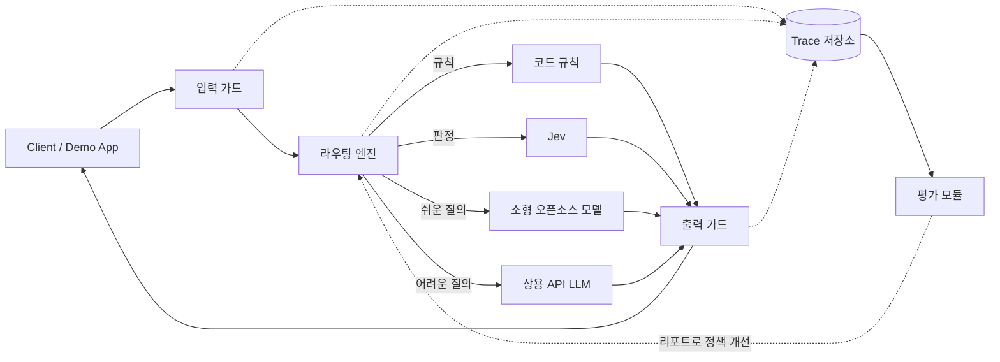

# LLMOps

LLM gateway with guardrails, cost-aware routing (rules · Jev · open-source SLMs · frontier APIs), and automated evaluation. Built with FastAPI.

> 이 서비스가 **무엇을 제공하는지**(기능 요구사항, 현재 상태, 범위 밖)는 [docs/product.md](docs/product.md)에 정리했다.

## 개요

LLM 요청이 지나가는 하나의 경로(**입력 가드 → 라우팅 → 모델 호출 → 출력 가드**)를 FastAPI 게이트웨이로 만들고, 모든 단계를 기록해 **설정을 바꿀 때마다 비용·지연·정확도·방어율을 자동으로 측정**하는 것이 목표이다.

핵심 원칙은 **역할 분리**이다. 하나의 모델에 모든 것을 맡기지 않고, 일의 성격에 맞는 도구를 배치한다.

| 구성요소 | 맡는 역할 |
|---|---|
| 코드·규칙 | 정확한 계산, 정규식, 임계값 비교, 1차 필터 |
| Jev | 선택지가 정해진 판정(분류, yes/no + 확률, 점수) |
| 소형 오픈소스 모델 (Transformers / vLLM) | 쉬운 질의 응답, 직접 파인튜닝한 분류기·judge |
| 상용 API LLM | 어려운 추론, 긴 답변, 평가 기준(reference) 생성 |
| 임베딩·리랭커 | 검색 (시연 앱의 RAG) |

Jev를 포함한 어떤 provider도 같은 인터페이스로 교체할 수 있게 설계하며, 같은 판정을 여러 방식으로 돌려 비교하는 것 자체가 평가 항목이다.

## 아키텍처



## 디렉터리 구조

Python 백엔드는 모두 `code/backend/` 아래에, 시연 화면(React)은 `code/frontend/`에 있다. 문서(설계, 결정 기록, 평가 결과)는 루트의 `docs/`이다. `code/frontend/`는 [시연 화면](#시연-화면)을 참고한다.

| 경로 (`code/backend/` 기준) | 설명 |
|---|---|
| `gateway/` | FastAPI 게이트웨이 (OpenAI 호환 API, 인증, 스트리밍, trace 기록) |
| `guards/` | 입력·출력 가드레일 (프롬프트 인젝션, PII, 정책 위반) |
| `router/` | 라우팅 엔진 (규칙 · Jev · 모델 선택, 신뢰도 임계값, fallback) |
| `providers/` | 모델 provider 추상화 (Jev, 상용 API, HF/vLLM) |
| `evals/` | 평가 데이터셋, judge, 벤치마크, 리포트 |

## 로드맵

- [x] **0. 기반**: 레포 구조, 환경 변수, 게이트웨이 골격
- [x] **1. 한 줄 관통**: 입력 가드 → 라우터 → LLM 호출 → trace 저장 (mock provider 기준으로 관통, 실제 모델 호출은 스모크 스크립트로 별도 확인 예정)
- [x] **2. 라우팅 엔진 v1**: 규칙 + Jev + 모델 2종, 신뢰도 기반 승격 (Jev 어댑터를 실제 API로 확인함. 정책 v1은 80문항 전부 easy로 판정해 개선 필요)
- [x] **3. 평가 v1**: 데이터셋, judge, 비용·지연·정확도 리포트 (Qwen + Jev로 80문항 첫 실측 완료: [결과](docs/evals/2026-10-13_qwen-first-run.md). n=80, 난이도 라벨은 검토 전이라 관찰로 읽을 것)
- [ ] **4. 가드 고도화**: 인젝션·PII 탐지, 공격 프롬프트 자동 생성, 방어율 측정
- [ ] **5. 파인튜닝**: 라우팅/가드 분류기, 소형 judge (1B 이하 모델 위주)
- [ ] **6. 벤치마크**: LLM 단독 vs 하이브리드, Jev vs 파인튜닝 분류기 vs LLM judge
- [ ] **7. 마무리**: 대시보드 정리, 시연 영상, 회고 (최소 시연 화면은 먼저 구현함: [시연 화면](#시연-화면))

## 시작하기

필요한 것: [uv](https://docs.astral.sh/uv/) (Python 3.12는 uv가 자동으로 받는다).

```bash
cd code/backend        # 이하 Python 명령은 모두 여기서 실행합니다 (.env도 이 폴더에 둡니다)
uv sync                # 의존성 설치 (.venv 생성)
cp .env.example .env   # PowerShell: Copy-Item .env.example .env
                       # GATEWAY_API_KEY 에 임의의 긴 문자열을 채우세요. .env 는 절대 커밋하지 마세요.
uv run uvicorn gateway.app:create_app --factory --port 8000
```

기본 설정은 오프라인 mock provider라서 API 키 없이 바로 시연할 수 있다.

```bash
curl http://localhost:8000/v1/chat/completions \
  -H "Authorization: Bearer $GATEWAY_API_KEY" -H "Content-Type: application/json" \
  -d '{"messages":[{"role":"user","content":"안녕하세요"}]}'
```

- 응답 헤더의 `X-Request-ID`가 trace의 키이다. 기본 저장소는 `code/backend/data/traces.sqlite3`(SQLite, 커밋되지 않음)이며 단계별(`guard` → `router` → `provider`) 판정·토큰·비용·지연이 기록된다.
- 입력 가드가 막으면 400이다. 라우팅된 모델이 실패하면 다른 경로의 실제 모델이 대신 답하고(응답 헤더 `X-LLMOps-Fallback: true`, trace에 기록), 모두 실패하면 502이다. 응답 헤더 `X-LLMOps-Route` / `X-LLMOps-Route-Reason` / `X-LLMOps-P-Easy`로 라우팅 결정도 볼 수 있다.
- 실제 모델 연결은 `.env`의 `SMALL_PROVIDER` / `FRONTIER_PROVIDER`로 켠다. 한 번만 실제 호출을 확인하는 스모크 스크립트는 `scripts/smoke_live.py`(기본 비활성)이다.

```bash
uv run pytest                                        # 테스트 (네트워크 없음, code/backend에서)
uv run ruff check . && uv run ruff format --check .  # 린트
```

### 시연 화면

질문을 보내면 경로·사유·`p(easy)`·모델·토큰·비용·지연이 한 화면에 보이는 React 앱이다. 게이트웨이가 빌드 결과를 `/demo`로 서빙한다.

```bash
cd code/frontend
npm ci            # 의존성 설치
npm run build     # code/frontend/dist 생성 (게이트웨이가 /demo 로 제공)
# 게이트웨이를 켜고 http://localhost:8000/demo/ 를 엽니다. 키는 화면의 입력칸에 넣습니다(저장되지 않음).
npm run dev       # 개발 서버 http://localhost:5173/demo/ (API는 8000 포트의 게이트웨이로 프록시)
npm test          # 단위 테스트
```

- `p(easy)`는 `ROUTER_MODE=hybrid`(또는 `judge_only`)에서 판정기를 거친 요청에만 표시된다. 실제 Jev로 보려면 `JUDGE_PROVIDER=jev`와 `ROUTER_PROMOTE_THRESHOLD=0.995` 같은 값이 필요하다.
- 화면을 끄려면 `DEMO_UI_ENABLED=false`. 빌드하지 않으면 `/demo`는 빌드 안내와 함께 503을 돌려준다.
- 이력 표는 이번 접속에서 보낸 요청만 보여 주며 서버에 저장하지 않는다.
- **라이트/다크 모드**: 처음에는 OS 설정을 따르고, 오른쪽 위 토글로 바꾼다(선택은 이 브라우저에만 기억).
- **애니메이션**: 요청이 `입력 가드 → 라우터 → 모델 → 응답`을 지나는 과정, 답변 타이핑, `p(easy)` 게이지, 숫자 카운트업 등. OS에서 "동작 줄이기"를 켜 두면 모두 꺼진다.

### 라우팅 모드 (2단계)

`.env`의 `ROUTER_MODE`로 고른다. 기본값 `rules`는 규칙만 쓰고 판정기를 호출하지 않는다.

| 모드 | 동작 |
|---|---|
| `rules` | 길이·키워드 규칙만 (기본) |
| `hybrid` | 규칙에 걸리면 확정, 아니면 판정기(Jev)가 easy/hard와 확률을 판정. `p(easy) ≥ ROUTER_PROMOTE_THRESHOLD`(0.7)일 때만 소형 모델, 아니면 상용 모델로 승격 |
| `judge_only` | 항상 판정기에 질의 (규칙과 비교 실험용) |

`JUDGE_PROVIDER`의 기본값은 오프라인 mock(요청 길이만 보는 가짜)이라 키 없이 동작을 볼 수 있지만, 라우팅 품질의 근거는 아니다. 실제 Jev는 `JUDGE_PROVIDER=jev`와 `JEV_API_KEY`가 필요하며, 어댑터는 서드파티 문서를 기준으로 작성했고 2026-10-13에 실제 호출로 확인했다. 판정 호출은 trace에 `judge` 이벤트(확률, 토큰, 비용, 지연, 정책 버전)로 남는다. 정책 문구는 [docs/prompts/router-policy-v1.md](docs/prompts/router-policy-v1.md)에 있다.

### 평가 (3단계)

라우팅 설정을 바꿨을 때 비용·지연·정확도가 어떻게 달라지는지 측정한다. 판정기·소형 모델·상용 모델을 항목당 한 번씩만 호출해 캐시하고, 모드와 임계값(τ)을 바꾼 비교는 캐시를 재생해서 계산하므로 τ를 훑어도 추가 비용이 없다.

```bash
uv run python -m evals.run collect --name demo --limit 20   # 기본 mock, 키 없이 실행
uv run python -m evals.run report  --name demo              # code/backend/evals/reports/demo/report.md
```

데이터셋(영어·한국어 80개)은 AI가 작성했고 난이도 라벨은 검토 전이다. mock으로 만든 리포트는 파이프라인이 동작한다는 것만 보여 주며 정확도·비용 수치에는 의미가 없다 (리포트 상단에 경고가 표시된다). 자세한 내용은 [code/backend/evals/README.md](code/backend/evals/README.md).

현재 구현 범위(로드맵 0~3단계): 규칙 기반 입력 가드 · 규칙/판정 하이브리드 라우터 · 비스트리밍 `/v1/chat/completions` · SQLite trace · 라우팅 평가 도구. 출력 가드, 스트리밍은 이후 단계이다.
