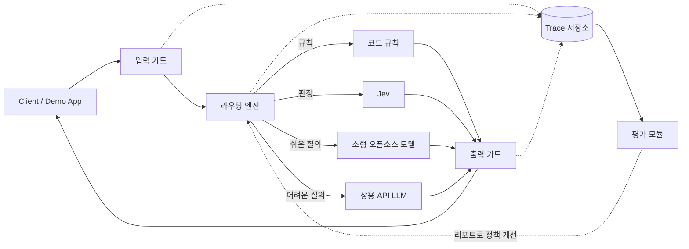

# LLMOps

LLM gateway with guardrails, cost-aware routing (rules · Jev · open-source SLMs · frontier APIs), and automated evaluation. Built with FastAPI.

> 2026-2학기 충북대학교 소프트웨어학부 AI 활용 대회 출품 프로젝트 (개발 진행 중)

## 개요

LLM 요청이 지나가는 하나의 경로(**입력 가드 → 라우팅 → 모델 호출 → 출력 가드**)를 FastAPI 게이트웨이로 만들고, 모든 단계를 기록해 **설정을 바꿀 때마다 비용·지연·정확도·방어율을 자동으로 측정**하는 것이 목표입니다.

핵심 원칙은 **역할 분리**입니다. 하나의 모델에 모든 것을 맡기지 않고, 일의 성격에 맞는 도구를 배치합니다.

| 구성요소 | 맡는 역할 |
|---|---|
| 코드·규칙 | 정확한 계산, 정규식, 임계값 비교, 1차 필터 |
| Jev | 선택지가 정해진 판정(분류, yes/no + 확률, 점수) |
| 소형 오픈소스 모델 (Transformers / vLLM) | 쉬운 질의 응답, 직접 파인튜닝한 분류기·judge |
| 상용 API LLM | 어려운 추론, 긴 답변, 평가 기준(reference) 생성 |
| 임베딩·리랭커 | 검색 (시연 앱의 RAG) |

Jev를 포함한 어떤 provider도 같은 인터페이스로 교체할 수 있게 설계하며, 같은 판정을 여러 방식으로 돌려 비교하는 것 자체가 평가 항목입니다.

## 아키텍처



## 디렉터리 구조

| 경로 | 설명 |
|---|---|
| `gateway/` | FastAPI 게이트웨이 (OpenAI 호환 API, 인증, 스트리밍, trace 기록) |
| `guards/` | 입력·출력 가드레일 (프롬프트 인젝션, PII, 정책 위반) |
| `router/` | 라우팅 엔진 (규칙 · Jev · 모델 선택, 신뢰도 임계값, fallback) |
| `providers/` | 모델 provider 추상화 (Jev, 상용 API, HF/vLLM) |
| `evals/` | 평가 데이터셋, judge, 벤치마크, 리포트 |
| `demo_app/` | 게이트웨이를 통과하는 시연용 서비스 |
| `docs/` | 설계 문서, 발표 자료, `ai-log/` (AI 대화 기록) |

## 로드맵

- [x] **0. 기반**: 레포 구조, 환경 변수, 게이트웨이 골격
- [x] **1. 한 줄 관통**: 입력 가드 → 라우터 → LLM 호출 → trace 저장 (mock provider 기준으로 관통, 실제 모델 호출은 스모크 스크립트로 별도 확인 예정)
- [ ] **2. 라우팅 엔진 v1**: 규칙 + Jev + 모델 2종, 신뢰도 기반 승격
- [ ] **3. 평가 v1**: 데이터셋, judge, 비용·지연·정확도 리포트
- [ ] **4. 가드 고도화**: 인젝션·PII 탐지, 공격 프롬프트 자동 생성, 방어율 측정
- [ ] **5. 파인튜닝**: 라우팅/가드 분류기, 소형 judge (1B 이하 모델 위주)
- [ ] **6. 벤치마크**: LLM 단독 vs 하이브리드, Jev vs 파인튜닝 분류기 vs LLM judge
- [ ] **7. 마무리**: 대시보드 정리, 시연 영상, 회고

## 시작하기

필요한 것: [uv](https://docs.astral.sh/uv/) (Python 3.12는 uv가 자동으로 받습니다).

```bash
uv sync                # 의존성 설치 (.venv 생성)
cp .env.example .env   # PowerShell: Copy-Item .env.example .env
                       # GATEWAY_API_KEY 에 임의의 긴 문자열을 채우세요. .env 는 절대 커밋하지 마세요.
uv run uvicorn gateway.app:create_app --factory --port 8000
```

기본 설정은 오프라인 mock provider라서 API 키 없이 바로 시연할 수 있습니다.

```bash
curl http://localhost:8000/v1/chat/completions \
  -H "Authorization: Bearer $GATEWAY_API_KEY" -H "Content-Type: application/json" \
  -d '{"messages":[{"role":"user","content":"안녕하세요"}]}'
```

- 응답 헤더의 `X-Request-ID`가 trace의 키입니다. 기본 저장소는 `data/traces.sqlite3`(SQLite, 커밋되지 않음)이며 단계별(`guard` → `router` → `provider`) 판정·토큰·비용·지연이 기록됩니다.
- 입력 가드가 막으면 400, 라우팅된 모델이 실패하면 오프라인 fallback으로 응답합니다(trace에 기록).
- 실제 모델 연결은 `.env`의 `SMALL_PROVIDER` / `FRONTIER_PROVIDER`로 켭니다. 한 번만 실제 호출을 확인하는 스모크 스크립트는 `scripts/smoke_live.py`(기본 비활성)입니다.

```bash
uv run pytest                                        # 테스트 (네트워크 없음)
uv run ruff check . && uv run ruff format --check .  # 린트
```

현재 구현 범위(로드맵 0~1단계): 규칙 기반 입력 가드 · 규칙 라우터 · 비스트리밍 `/v1/chat/completions` · SQLite trace. 출력 가드, Jev 판정, 스트리밍은 이후 단계입니다.

## AI 활용 기록

대회 규정에 따라 AI와의 대화 기록을 `docs/ai-log/` 에 날짜별로 보관합니다. 작성 방법은 [docs/ai-log/README.md](docs/ai-log/README.md) 를 참고하세요.
