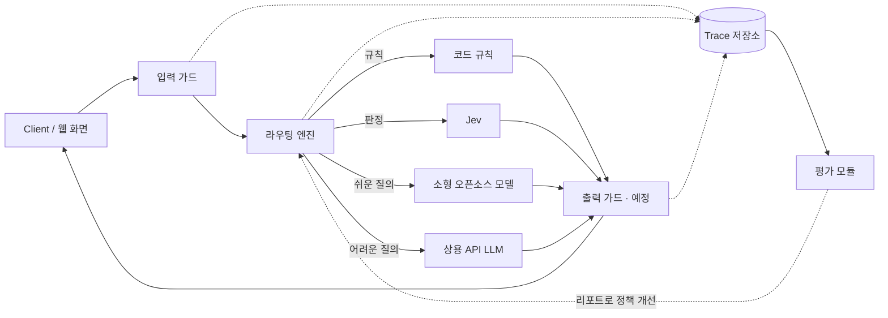

# LLMOps

LLM gateway with guardrails, cost-aware routing (rules · Jev · open-source SLMs · frontier APIs), and automated evaluation. Built with FastAPI and React.

OpenAI SDK의 `base_url`만 바꾸면 쉬운 요청은 값싼 소형 모델로, 어려운 요청은 상용 모델로 보내고, 위험한 입력은 모델에 닿기 전에 막고, **얼마를 아꼈는지** 보여 주는 게이트웨이이다. 라우팅 설정을 바꿀 때마다 비용·지연·정확도를 측정하는 평가 도구가 함께 들어 있다. 이 서비스가 무엇을 제공하는지(기능 요구사항, 현재 상태, 범위 밖)는 [docs/product.md](docs/product.md)에 있다.

## 특징

- **OpenAI 호환 API**: `POST /v1/chat/completions`. 기존 코드에서 주소와 키만 바꾸면 된다(스트리밍은 아직 없다).
- **비용 인식 라우팅**: 코드 규칙과 판정 모델(Jev)의 `p(easy)`, 신뢰도 임계값으로 소형/상용 모델을 고른다. 판정기가 실패하면 규칙 결과로 대체한다.
- **장애 대체**: 고른 모델이 실패하면 다른 경로의 실제 모델이 대신 답한다. 가짜 응답으로 대신하지 않고, 모두 실패하면 502이다.
- **입력 가드**: 빈 입력, 길이 초과, 영어·한국어 프롬프트 인젝션을 모델 호출 전에 막는다.
- **투명성과 측정**: 모든 단계를 요청 ID와 함께 기록하고 결정을 응답 헤더로 돌려준다. 웹 화면(`/`)에서 경로·비용·아낀 금액을 볼 수 있고, 평가 도구가 설정별 정확도·비용을 비교한다.

## 빠른 시작

모든 provider의 기본값은 오프라인 mock이라 API 키 없이 실행해 볼 수 있다.

**Docker**

```bash
cp code/backend/.env.example code/backend/.env   # GATEWAY_API_KEY 에 임의의 긴 문자열을 채운다 (.env 는 커밋하지 않는다)
docker compose up --build
```

> `Dockerfile`과 `compose.yaml`은 작성 환경에 Docker가 없어 이미지 빌드를 직접 실행해 보지 못했다(같은 단계는 Docker 없이 확인했다). 문제가 있으면 이슈로 알려 주기 바란다.

**직접 실행** (필요한 것: [uv](https://docs.astral.sh/uv/), 웹 화면을 빌드할 때만 Node.js)

```bash
cd code/frontend && npm ci && npm run build      # 웹 화면 빌드 (건너뛰면 API만 동작한다)
cd ../backend
uv sync
cp .env.example .env                             # GATEWAY_API_KEY 를 채운다. PowerShell: Copy-Item .env.example .env
uv run uvicorn gateway.app:create_app --factory --port 8000
```

`http://localhost:8000/`에서 웹 화면이, `/v1/chat/completions`에서 API가 열린다.

## 사용법

`base_url`과 `api_key`(= `GATEWAY_API_KEY`)만 바꾼다. `model` 값은 받아 주지만 라우터가 모델을 고른다.

```python
from openai import OpenAI

client = OpenAI(base_url="http://localhost:8000/v1", api_key="<GATEWAY_API_KEY>")
raw = client.chat.completions.with_raw_response.create(
    model="auto", messages=[{"role": "user", "content": "What is 2+2?"}]
)
print(raw.parse().choices[0].message.content)
print(raw.headers["X-LLMOps-Route"], raw.headers["X-LLMOps-Cost-USD"])   # 라우팅 결정은 응답 헤더로 읽는다
```

```bash
curl http://localhost:8000/v1/chat/completions \
  -H "Authorization: Bearer $GATEWAY_API_KEY" -H "Content-Type: application/json" \
  -d '{"messages":[{"role":"user","content":"Hello"}]}'
```

| 헤더 | 의미 |
|---|---|
| `X-LLMOps-Route` | 라우터가 고른 경로(`small` / `frontier`) |
| `X-LLMOps-Fallback` | 다른 모델이 대신 답했는지(`true` / `false`) |
| `X-LLMOps-Cost-USD` | 이 요청의 비용(판정 호출 포함) |
| `X-LLMOps-Baseline-Cost-USD` | 같은 답을 상용 모델 단가로만 계산한 값. 둘의 차이가 아낀 금액(추정치) |

나머지 헤더와 오류 형식은 [gateway 문서](code/backend/gateway/README.md)에 있다.

## 구조

요청은 입력 가드 → 라우팅 → 모델 호출을 지나고, 모든 단계가 trace로 남아 평가 모듈이 설정별 비용·지연·정확도를 측정한다. 출력 가드는 아직 없다.



계산은 코드가, 선택지가 정해진 판정은 Jev가, 쉬운 질의는 소형 모델이, 어려운 추론은 상용 모델이 맡는다([역할 분리](docs/architecture.md#역할-분리)). 백엔드는 `code/backend/`, 웹 화면은 `code/frontend/`, 설계·결정·평가 결과는 `docs/`에 있다.

## 로드맵

- [x] **0. 기반**: 레포 구조, 환경 변수, 게이트웨이 골격
- [x] **1. 한 줄 관통**: 입력 가드 → 라우터 → 모델 호출 → trace 저장
- [x] **2. 라우팅 엔진 v1**: 규칙 + Jev + 모델 2종, 신뢰도 기반 승격 (기본 판정 정책 v2a)
- [x] **3. 평가 v1**: 데이터셋, judge, 비용·지연·정확도 리포트 ([첫 실측](docs/evals/2026-10-13_qwen-first-run.md): n=80, 라벨 검토 전이라 관찰로 읽을 것)
- [ ] **4. 가드 고도화**: 인젝션·PII 탐지, 공격 프롬프트 자동 생성, 방어율 측정
- [ ] **5. 파인튜닝**: 라우팅/가드 분류기, 소형 judge (1B 이하 모델 위주)
- [ ] **6. 벤치마크**: LLM 단독 vs 하이브리드, Jev vs 파인튜닝 분류기 vs LLM judge
- [ ] **7. 마무리**: 대시보드 정리, 회고 (최소 웹 화면은 먼저 구현함)

그 밖에 필요한 것은 스트리밍, 출력 가드, 키별 trace 조회, 사용자별 키·요청 한도, PostgreSQL이다.

## 문서와 기여

- 문서 색인은 [docs/README.md](docs/README.md)에 있다. 설계와 결정 기록은 [architecture.md](docs/architecture.md), 실측 결과는 [docs/evals/](docs/evals/)이다.
- 모듈별 안내: [백엔드](code/backend/README.md) · [라우터](code/backend/router/README.md) · [평가 도구](code/backend/evals/README.md) · [웹 화면](code/frontend/README.md)
- 개발 환경과 기여 규칙은 [CONTRIBUTING.md](CONTRIBUTING.md), 취약점 신고는 [SECURITY.md](SECURITY.md), 변경 내역은 [CHANGELOG.md](CHANGELOG.md)에 있다.

## 라이선스

[MIT License](LICENSE)이다.
